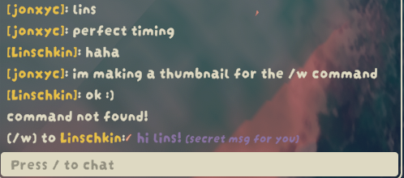

# TinyTweaks

## A few Tweaks/Customizations Toggleable

### Host Only
- Marshmallow protection (only 1 for each scout!)
- Correct Marshmallow spawns (for more than 4 scouts, including % for hotdog)
- Hunger & Cold Shield near campfire - gets your lowest hunger and reverts it to that one, removes all cold
- Extra Backpacks toggle
- Extra Any Backpack % and Fannypack %- you can now decide how many scouts(percent wise, so for 10 scouts, 50% is 5 scouts) get a backpack!(and what chance it is for a fannypack to spawn instead)
- Extra Marshmallows per scout- up to 21 per scout!(with protection)
- Cheat Marshmallows (add up to 250 extra marshmallows)
- Cooked Marshmallows - you can now spawn cooked marshmallows instead!(saving a few seconds at a time) (default false)
- Basketball Aimbot - basketball aimbot to hoop(configurable)
- Using Multiple Elevators (default off)
- always spawn rope in airport (default on)

### Server-Sided
- `/sit` command - you can sit now, and everyone will be able to see it!
- NoobSash- hides your badges
- Dead+Passed out eyes - yes, others can see it too - with keybinds you can set!
- dagger protection - people can't stab and kill you(disabled by default)
- blowgun protection - people can't blowgun you(disabled by default, works if unconscious)
- rescue claw protection - people can't rescue claw you(disabled by default, works if unconscious)
- bingbongSaysThis - bingbong will always say X! (guide for sentences in the wiki)
- RedRope - replaces normal rope with fancy red rope(yes, everyone can see it)
- You can now drop any item(passport, golden claw...)
- Animation overrides(off by default) - you can now change your default walking/running/left-right/backwards animations!
- `/ohno` command- plays a secret oh no animation for everyone to see! 
- Whisper in [PeakTextChat](https://thunderstore.io/c/peak/p/borealityy/PeakTextChat/), usage: `/w PersonName msg`. You can now send a private message between you and that person (for ex. snitch to the host if someone is cheating), even if they don't have tinyTweaks installed **YET**.

### Client-Sided
- player Counter (plrAmount/maxAmount) can use '(', '[', '{' and no brackets. (default on, no brackets)
- alwaysShowNames - I had to include this since [AlwaysDisplayPlayerName](https://thunderstore.io/c/peak/p/Yueby/AlwaysDisplayPlayerName/) doesn't always display names/ displays incorrect names, use [PEAKER](https://thunderstore.io/c/peak/p/lammas123/PEAKER/), since this tweak only forces the names to show
- moveAscent - manages Ascent's color and position (Customizable)
- NoBonusStaminaFromJumps - doesn't take bonusStamina when you sprint+jump when you're out of stamina and can still sprint+jump (default off)
- leave button for when you're infinitely loading, someone deletes your character, etc... (default none)(i binded mine to rightArrow) -hold for 5 seconds
- Can remove glowing pickup/pickup text/rope text/piton text (customizable)

## How To Use
* using [ModMenu](https://thunderstore.io/c/peak/p/PEAKModding/ModConfig/)
* using a Mod Manager for Ex.  [Gale](https://github.com/Kesomannen/gale)
* Editing the .cfg file yourself

## Credits
- Linschkin - helped with testing! ty lins!
- jozie - best intern I ever had, excellent ad man/salesperson (he's that one guy saying "download tinyTweaks" in your lobbies)
- Trunkica - making the wiki for BingBongSaysThis(located in the Mod's Wiki section)
- garry_tw - adding Version Text Color and Ascent Text Color
- Kiki - helping with testing and giving ideas for new features(also fixed the sitting bug)
